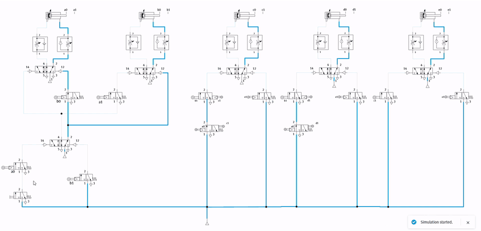
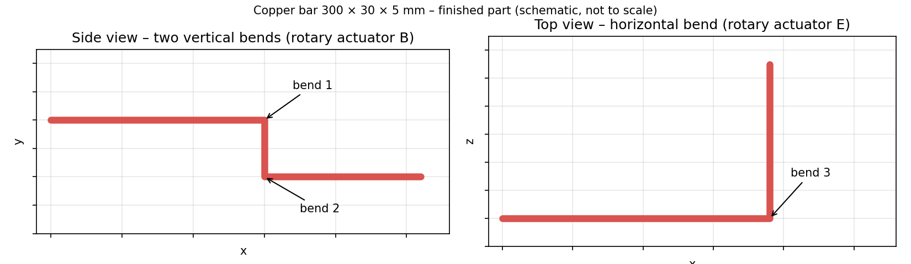
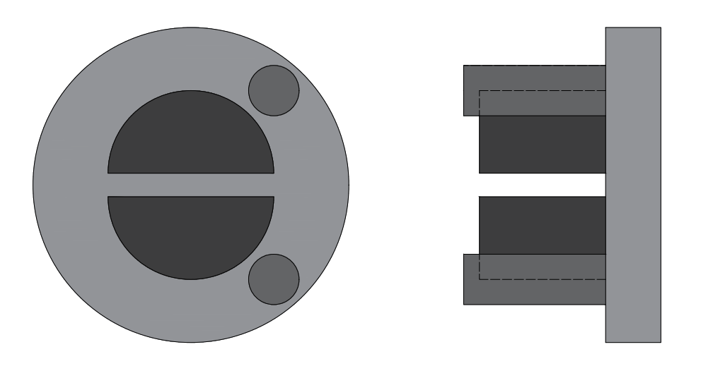
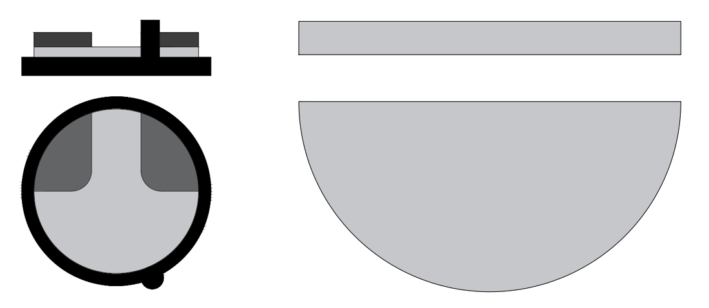
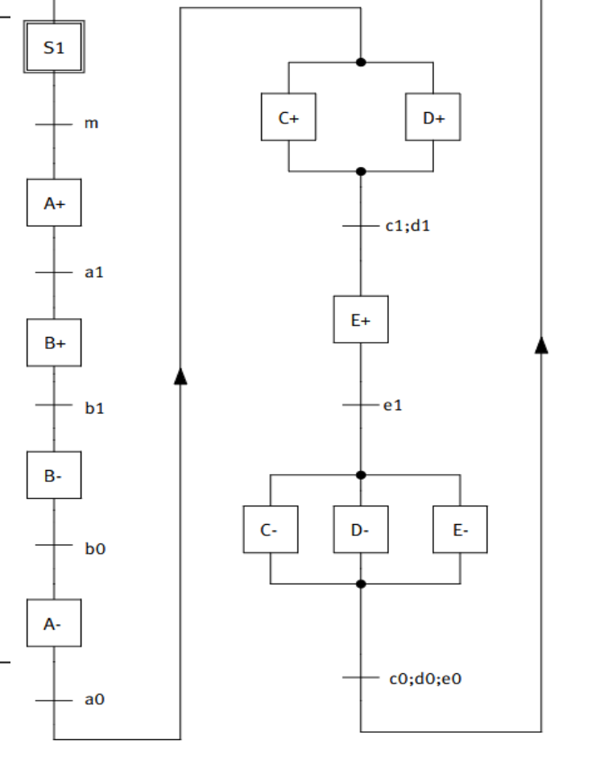
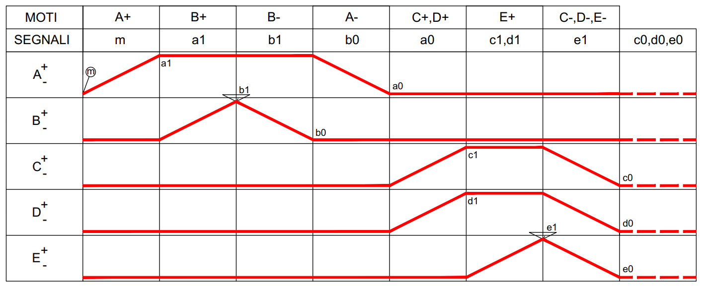
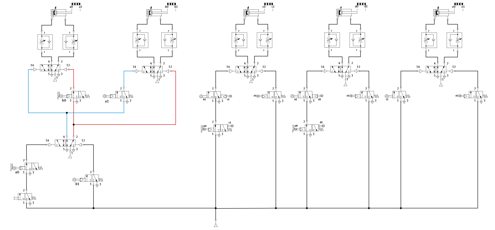

# Pneumatic Bar-Bending Machine – Sequence Design, Circuit and Actuator Sizing

Group project for the course **Macchine Automatiche** (Automatic Machines), B.Sc. in Automation Engineering, **University of Bologna**, A.Y. 2024/2025.
Developed by **Michael Quattrini, Almen Selimi, Nicola Gaiotto and Federico Rinieri**.

The project designs the all-pneumatic automation of a machine that bends copper bars. It takes inspiration from an industrial bending/punching machine (UnionSpring US-TP35-6). Starting from the part to be produced, it defines the actuators and their working sequence (GRAFCET and phase diagram), then builds the pneumatic logic circuit with the **cascade method** and verifies it in **Festo FluidSIM**. Finally, it **sizes every actuator** on catalogue components and computes the air consumption per cycle.



---

## The part

The workpiece is a **copper bar of 300 × 30 × 5 mm**. The machine produces **two vertical bends** (a step in the side view) and **one horizontal bend** (an L in the top view).



## Actuators

| | Function | Type | Selected component |
|---|---|---|---|
| **A** | Feeds the vertical-bending unit towards the bar | Linear, double-acting | Festo DSNU-16-50-P-A |
| **B** | Vertical bends (B+ first bend, B− opposite bend) | Rotary, rack-and-pinion, 180° | Festo DRRD-35-180-FH-PA |
| **C** | Lifts the horizontal-bending unit to the bar | Linear, double-acting | Festo DSNU-16-60-P-A |
| **D** | Clamps the bar so the horizontal bend stays on axis | Linear, double-acting | Festo DSNU-16-60-P-A |
| **E** | Horizontal bend | Rotary, rack-and-pinion, 180° | Festo DRRD-63-180-FH-PA |

The vertical-bending unit (B) is a rotating disc with two pins that grip the bar and fold it as the disc turns (front and side view):



The horizontal-bending unit (E, left: front and top view) works the same way about the other axis. The clamp (D, right) presses a semicircular pad lightly on the bar so the horizontal bend does not go off axis:



## Working sequence

After the start button `m`, the bar is fed out by 150 mm. A advances the vertical-bending unit and B makes the first bend. The bar advances by 40 mm, B makes the opposite bend, and A retracts. The bar then advances by 60 mm. C lifts the horizontal-bending unit while D clamps the bar, E makes the horizontal bend, and finally C, D and E return together and the finished part is released.

$$
A^+ \;\; B^+ \;\; B^- \;\; A^- \;\; (C^+\,D^+) \;\; E^+ \;\; (C^-\,D^-\,E^-)
$$

<table><tr>
<td></td>
<td></td>
</tr></table>

The phase diagram shows a **blocking signal**: `a1` is still active when the sequence needs `A−`, so a purely sensor-driven circuit would lock. It is resolved with the **cascade method**. A memory valve splits the A/B sub-sequence into two pressure groups, so that each end-of-stroke signal is fed only while it is needed.

## Pneumatic circuit

Each cylinder is driven by a double-piloted 5/2 valve. Speed is regulated by one-way flow-control valves on both ports. The sequence advances through roller-operated 3/2 end-of-stroke valves (`a0 … e1`), which interlock each movement with the completion of the previous one.



The circuit was built and simulated in **Festo FluidSIM** (animation at the top): active lines are highlighted as the cylinders move through the cycle.

## Actuator sizing

All calculations are reproduced in [`sizing/actuator_sizing.py`](sizing/actuator_sizing.py). The supply pressure is $p = 6$ bar, the load ratio is $R = 0.7$, and friction takes 15 % of the theoretical force or torque.

**Rotary actuators.** The torque must exceed the moment that yields the copper bar ($\sigma_y = 70$ MPa). That moment is $M = \sigma_y W$, where the section modulus $W$ depends on which side of the bar is bent:

$$
M_{teo} = \frac{\sigma_y\,W}{R\,(1-0.15)}, \qquad
W_{vertical} = \frac{w\,t^2}{6} = 125\ \text{mm}^3, \qquad
W_{horizontal} = \frac{w^2\,t}{6} = 750\ \text{mm}^3
$$

**Linear cylinders.** The required force comes from the weight of the unit being moved (A, C) or from the clamping force (D). The minimum bore follows from $F_{teo} = \pi d^2 p/40$, with $d$ in mm, $p$ in bar and $F$ in N.

| | Requirement | Theoretical need | Selected | Catalogue rating |
|---|---|---|---|---|
| A | move 4.5 kg | 74.2 N → bore ≥ 12.5 mm | DSNU-16-50 | Ø 16 mm |
| B | yield bar (thin side) | 14.7 Nm | DRRD-35 | 15.8 Nm |
| C | move 6.5 kg | 107.2 N → bore ≥ 15.1 mm | DSNU-16-60 | Ø 16 mm |
| D | clamp with 80 N | 94.1 N → bore ≥ 14.1 mm | DSNU-16-60 | Ø 16 mm |
| E | yield bar (wide side) | 88.2 Nm | DRRD-63 | 112 Nm |

**Air consumption.** Free air per cycle is computed at the absolute pressure of 7 bar. For the linear cylinders it is $Q = (q_s + q_t)\,s$ (extension plus retraction). The rotary actuators are approximated as two double-acting cylinders with the internal bore and a 5 cm stroke.

| A | B | C | D | E | **Total** |
|---|---|---|---|---|---|
| 0.12 | 1.35 | 0.14 | 0.14 | 4.36 | **≈ 6.1 dm³/cycle** |

The horizontal-bend actuator E accounts for about 70 % of the air demand, because bending the bar about its wide side needs six times the moment of a vertical bend.

---

## Repository structure

```
├── sizing/
│   └── actuator_sizing.py   Actuator sizing and air-consumption calculations
└── figures/                 Sequence, circuit, mechanisms and FluidSIM animation
```

```
python sizing/actuator_sizing.py
```

## Authors

- Michael Quattrini
- Almen Selimi
- Nicola Gaiotto
- Federico Rinieri

University of Bologna, Macchine Automatiche, A.Y. 2024/2025.
